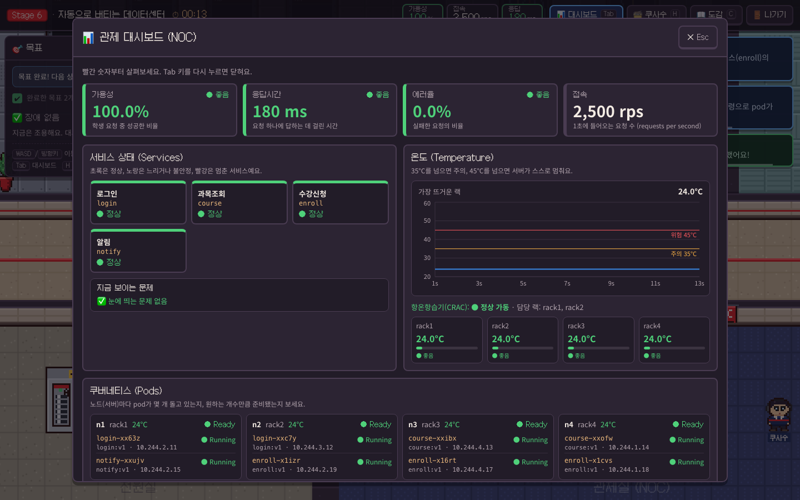
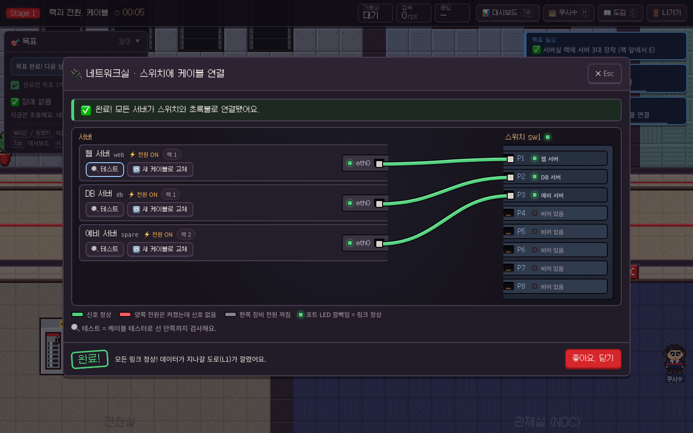

# KHU 데이터센터: 수강신청을 지켜라

경희대학교 데이터센터의 신입 엔지니어(경희대 사자 🦁)가 되어 **수강신청 시스템**을 지키는 브라우저 게임이에요.
서버를 거의 몰라도 괜찮아요. 케이블 한 줄 꽂는 것부터 시작해서, 마지막엔 쿠버네티스(Kubernetes) 클러스터로 본 수강신청 트래픽을 버텨요.

- **네트워크**: OSI 7계층 L1–L4, IP 주소 · DHCP · DNS · 게이트웨이(Gateway), 포트(Port) · 소켓(Socket) · HTTP 상태 코드
- **마이크로서비스**: 모놀리스(Monolith) → MSA, 컨테이너(Docker) · 이미지 · 포트 매핑 · 볼륨, 쿠버네티스 개념(Self-healing, Service, Scale-out, Rollback)
- 장애가 나면 **증상만** 알려줘요. 대시보드와 터미널로 원인을 찾아 직접 고쳐요. 막히면 AI 사수 **쿠사수**가 정답 대신 힌트를 줘요.

## 스크린샷

| 데이터센터 (Stage 7 복합 장애) | 관제 대시보드 (Stage 6) |
|---|---|
|  |  |
| **터미널 (Stage 2)** | **케이블 미니게임 (Stage 1)** |
|  |  |

## 빠른 시작

필요한 것: **Node.js 20.19 이상** (22 LTS 권장)

```bash
npm install
npm run dev          # → http://localhost:5173
```

AI 없이도 끝까지 플레이할 수 있어요. 힌트는 각 장애에 미리 적어둔 3단계 힌트로 나와요.

### (선택) AI 사수 켜기 — ChatKHU

쿠사수가 지금 상황을 보고 힌트를 직접 말하게 하려면 Cloudflare Worker를 함께 띄워요.

```bash
cd worker
npm install
cp .dev.vars.example .dev.vars   # ChatKHU 로그인 → 왼쪽 아래 API Gateway → API 키 생성 → CHATKHU_API_KEY= 뒤에 붙여넣기
npm run dev                      # → http://localhost:8787 (wrangler dev)
```

다른 터미널에서 게임(`npm run dev`)을 켜면 Vite가 `/api` 요청을 `:8787` 로 넘겨줘요 (`vite.config.ts` 의 proxy).
Worker의 `npm run dev` 는 `dist/` 가 없으면 빈 폴더를 먼저 만들어요. 개발 중엔 `/api` 만 쓰니까 빌드할 필요가 없어요.
(`:8787` 에서 게임 화면까지 보고 싶을 때만 루트에서 `npm run build` 를 먼저 하세요.)
`.dev.vars` 는 `.gitignore` 에 들어 있어요. **API 키는 절대 커밋하지 마세요.**
키가 없거나, 응답이 늦거나(12초), AI가 정답을 너무 직접 말하면 자동으로 기본 힌트로 돌아가요.

## 조작법

| 키 | 하는 일 |
|---|---|
| WASD / 방향키 | 이동 |
| E | 앞에 있는 장비와 상호작용 (랙, 스위치, PDU, 관리 PC, 화이트보드 …) |
| Tab | 대시보드(관제 화면) 열기/닫기 |
| H | 쿠사수 무전기 (힌트) 열기/닫기 |
| C | 개념 도감 열기/닫기 |
| Esc | 열린 창 닫기 (창 위에서 연 창이면 원래 창으로 돌아가요. 터미널은 하던 그대로) |
| Enter / 클릭 | 대화 넘기기 |
| M | 소리 켜기/끄기 (HUD와 타이틀 화면의 🔊 버튼과 같아요. 설정은 저장돼요) |
| 🏃 버튼 | 이동 속도 1x → 1.5x → 2x (설정은 저장돼요) |

터미널에서는 `help` 로 그 단계에서 쓸 수 있는 명령어를 볼 수 있고, `hint` 로 쿠사수를 부를 수 있어요.
힌트는 1단계(관찰 질문) → 2단계(방향) → 3단계(도구/명령 종류) 순서로 나와요. 힌트와 "정답 보기"는 점수(★)가 조금씩 깎여요.

## 스테이지

| # | 제목 | 배우는 것 |
|---|---|---|
| 0 | 입사 첫날 | 데이터센터란? · 서버와 클라이언트 · 조작법 |
| 1 | 랙과 전원, 케이블 | 랙 장착 · PDU/UPS · 케이블과 link LED · OSI L1 · 단일 장애점(SPOF) |
| 2 | 서로 대화하게 만들기 | MAC · IP · DHCP · DNS · 게이트웨이 · ping |
| 3 | 서비스 오픈 | 포트 · TCP 3-way handshake · 소켓/멀티스레드 · HTTP 상태 코드 · curl |
| 4 | 수강신청 대란 1 | 모놀리스 vs MSA · 장애 격리 · 독립 확장 · DB per service |
| 5 | "내 컴퓨터에선 되는데…" | VM vs 컨테이너 · Dockerfile · 레지스트리 · 포트 매핑(-p) · 볼륨 |
| 6 | 자동으로 버티는 데이터센터 | Pod · Node · 원하는 상태 · Self-healing · Service · Scale-out · Rollback |
| 7 | 수강신청 본게임 | 복합 장애 우선순위(triage) · 150초 버티기 · 장애 보고서(Postmortem) |

## 프로젝트 구조

```
src/
  sim/            순수 시뮬레이션 엔진 (React/Phaser 없음, 테스트 가능)
    types.ts        World(장비·케이블·전원·네트워크·앱·Docker·k8s·냉각) · Health
    engine.ts       StageRun: 틱, 목표, 장애 활성화/해결, 점수
    scenario.ts     Scenario 타입과 트리거
    network.ts      전원 · 링크 · ping · DNS 해석
    app.ts, k8s.ts  모놀리스/MSA 서비스, 쿠버네티스 reconcile
    actions.ts      미니게임이 세상을 바꾸는 손 (mount, connectCable, repairCrac …)
    commands/       터미널 명령어 (net, web, svc, docker, k8s)
  content/        스테이지 데이터
    stages/         stage0.ts … stage7.ts (목표 · 장애 시나리오 · 상호작용 · 대화)
    concepts.ts     개념 카드 (비유 사전)
    manual/         AI 사수가 읽는 운영 매뉴얼 stage0.md … stage7.md
  store/game.ts   Zustand 스토어 (화면, 모달, 대화, 힌트, 저장)
  ui/             React UI (HUD, 대시보드, 터미널, 미니게임, 보드, 힌트 채팅)
  audio/          소리: engine.ts (Web Audio, 크로스페이드) · director.ts (게임 상태 → 음악/경보/코인/징글) · logic.ts (테스트하는 순수 규칙: 곡 선택, 음량 맞춤, 효과음 규칙)
  game/           Phaser 3 맵과 사자 캐릭터
  ai/client.ts    /api/hint 호출 + 실패 시 기본 힌트
worker/           Cloudflare Worker: dist 정적 서빙 + POST /api/hint (ChatKHU 프록시)
tests/            vitest: 스테이지 전체 자동 플레이 테스트
e2e/              Playwright 스모크 테스트
art/              사자 원본 그림 · scripts/prepare-sprites.mjs 로 변환
public/assets/audio/  배경음악(로비 · 스테이지 · 장애) · 효과음(경보 · 코인 · 징글) · 대화 소리 (출처와 라이선스: docs/ASSETS.md)
```

## 장애 시나리오 추가하기

1. `src/sim/scenario.ts` 의 `Scenario` 타입을 보세요. 필요한 것:
   - `trigger` (언제 터질지: `stageStart` · `after` · `objective` · `condition`), `inject` (세상을 망가뜨리기), `check` (고쳐졌는지)
   - `alert` (플레이어가 보는 **증상**. 원인은 쓰지 않기), `room` (먼저 가볼 방)
   - `hints` 3개 (관찰 질문 → 방향 → 도구 종류), `bannedPhrases` (AI가 절대 말하면 안 되는 정답 표현. `solutionSteps` 의 명령과 그 안의 IP · 포트 쌍 · `KEY=VALUE` 는 Worker가 자동으로 막아요)
   - `solution` (정답 보기 문구), `solutionSteps` (정답을 실제로 실행하는 단계: 터미널 명령 `{cmd, host}` 또는 `{action, label}`)
   - `concept` (`src/content/concepts.ts` 의 id), `lesson`, `courseRef`
2. 해당 스테이지 파일(`src/content/stages/stageN.ts`)의 `scenarios` 배열에 추가해요.
3. AI 사수가 알 수 있게 `src/content/manual/stageN.md` 에 진단 순서(무엇을 보고, 어떤 명령으로, 정상/비정상은 어떻게 보이는지)를 적어요.
4. `npm test` — `tests/playthrough.test.ts` 가 모든 스테이지를 자동으로 플레이하면서, 장애가 터지면 **정말 망가졌는지** 확인하고 `solutionSteps` 를 실행해 **정말 고쳐지는지** 검사해요.

## 사자 그림 바꾸기

원본은 `art/` 에 있어요 (투명 배경 PNG, 1024×1024).

- `art/lion_walk.png`, `art/lion_angry.png`: 4×4 칸(한 칸 256px). 행 순서 = **아래, 왼쪽, 오른쪽, 위**. 각 행의 첫 칸은 서 있는 자세.
- `art/lion_extras.png`: 초상화 2개(웃음/걱정) + 대기 2프레임 + 수리 2프레임. 자르는 위치는 `scripts/prepare-sprites.mjs` 의 `EXTRAS` 좌표.

```bash
npm run sprites
```

결과물 (`public/assets/`):

| 파일 | 크기 | 배치 |
|---|---|---|
| `sprites/lion_walk.png`, `sprites/lion_angry.png` | 384×384 | 4×4 프레임(96×96), 행 = 아래·왼쪽·오른쪽·위, 0번 = 서 있기 |
| `sprites/lion_idle.png` | 192×96 | 2프레임 (2번째 = 눈 깜빡) |
| `sprites/lion_fix.png` | 192×96 | 2프레임 (드라이버 들고 쭈그려 앉기) |
| `portraits/lion_happy.png`, `portraits/lion_worried.png` | 192×192 | 대화창 초상화 |

## 배포 (Cloudflare Workers)

Worker 하나가 게임 정적 파일(`dist/`)과 `/api/hint` 를 함께 서빙해요.

```bash
npm run build                                  # → dist/
cd worker
npx wrangler login                             # 처음 한 번
npx wrangler secret put CHATKHU_API_KEY        # 키는 secret 으로 (파일에 적지 않기)
npx wrangler deploy
```

- 설정: `worker/wrangler.toml` (`[assets] directory = "../dist"`, SPA 모드, `/api/*` 만 Worker 코드가 먼저 처리)
- 모델 바꾸기: `[vars] HINT_MODEL` (기본 `claude-haiku-5-5`)
- 번들만 확인: `cd worker && npx wrangler deploy --dry-run --outdir /tmp/khu-worker-dry`

## AI 활용 기록 (서식4)

`/api/hint` 는 AI를 부를 때마다 JSON 한 줄을 `console.log` 로 남겨요. API 키와 질문 원문은 남기지 않아요.

```json
{"event":"hint","ts":"2026-10-19T11:31:23.749Z","scenarioId":"s2-dns","level":2,"model":"claude-haiku-5-5","latencyMs":1830,"leaked":false,"retried":false,"replyLength":54,"outcome":"ok","inputTokens":2310,"outputTokens":61,"questionLength":0}
```

- `leaked`: AI 답에 정답 표현(`bannedPhrases`, 정답 명령, 정답 명령 속 IP · 포트 쌍 · `KEY=VALUE` 값)이 들어가서 한 번 다시 물었는지. 두 번째도 유출되면 기본 힌트로 대체(`outcome: "fallback"`).
- 로컬: `wrangler dev` 터미널에 그대로 찍혀요.
- 배포본: 아래처럼 모아서 제출 서류(서식4)의 AI 사용 기록으로 정리하세요.

```bash
cd worker
npx wrangler tail --format json > ai-usage.json      # 플레이하는 동안 켜두기 (Ctrl+C 로 종료)
# 힌트 기록만 한 줄씩 뽑기 (jq 필요: macOS 15 이상 기본 포함, 또는 brew install jq)
jq -c '.logs[]?.message[]? | fromjson? | select(.event == "hint")' ai-usage.json > hint-log.jsonl
```

`hint-log.jsonl` 한 줄 = AI 호출 한 번이에요. 호출 수, 평균 응답시간(`latencyMs`), 토큰 수, 유출 차단 횟수(`leaked`)를 표로 정리하면 돼요.

## 테스트

```bash
npm test                         # vitest: 엔진 + 스테이지 0–7 자동 플레이
npx playwright install chromium  # (처음 한 번) 브라우저 설치
npm run e2e                      # Playwright 스모크: 시작 → 인트로 → 이동 → 대시보드 → 개념 도감, 콘솔 에러 0
                                 #   (창이 1280×720 · 1920×1080 화면 안에 들어오는지도 확인)
npm --prefix worker run typecheck  # Worker 타입 검사
```

