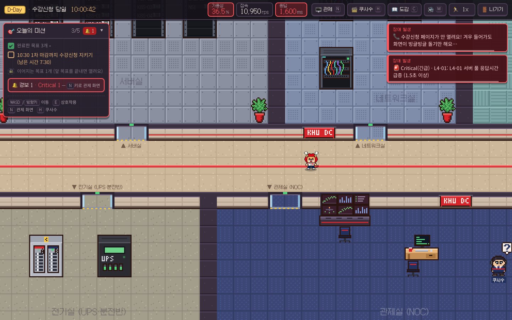
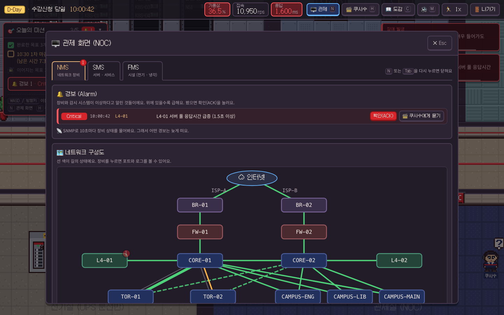
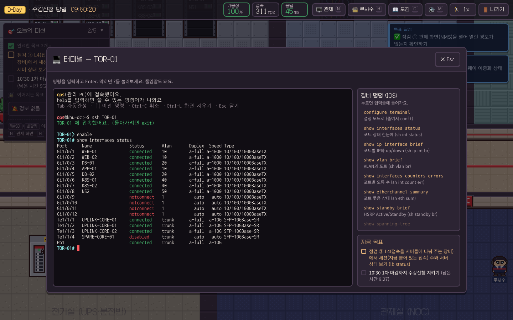
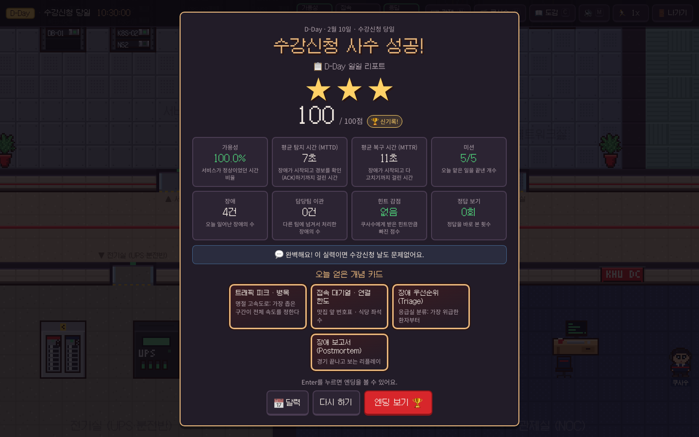

# KHU 데이터센터: 수강신청을 지켜라

**팀명: strawberry cone** · 저장소: Strawberrycone_KHUAI_Challenge

경희대학교 데이터센터의 신입 엔지니어(경희대 사자)가 되어, 닷새 동안(D-5 → D-1) 서버실을 직접 꾸리고 **D-Day 아침 10시에 열리는 수강신청**을 지켜내는 브라우저 게임이에요.
서버를 거의 몰라도 괜찮아요. 첫날은 랙에 서버를 끼우고 케이블을 꽂는 것부터 시작해서, 마지막 날엔 실시간으로 울리는 경보를 보며 몰려드는 수강신청 트래픽을 버텨요.

- **하루에 한 층씩**: 물리(랙 · 전원 · 케이블) → 네트워크(VLAN · 게이트웨이 · DHCP · DNS) → 서비스(포트 · L4 · MSA) → 컨테이너와 링크(Docker · LACP · STP) → 이중화(쿠버네티스 · HSRP) → 수강신청 당일.
- **진짜 장비처럼**: 관리 PC의 리눅스 셸, `ssh CORE-01` 로 들어가는 스위치 명령줄(Cisco IOS 스타일), L4 · 방화벽 · DHCP · DNS 서버의 전용 명령.
- **증상만 알려줘요**: 장애가 나면 "사이트가 안 열려요" 같은 증상과 경보만 와요. 관제 화면(NMS / SMS / FMS)에서 경보를 확인(ACK)하고, 터미널로 원인을 찾아 직접 고쳐요. 막히면 AI 사수 **쿠사수**가 정답 대신 힌트를 줘요.
- **하루가 끝나면 일일 리포트**: 가용성, 평균 탐지 시간(MTTD), 평균 복구 시간(MTTR)을 실제 운영팀처럼 받아요.

## 스크린샷

| 데이터센터 맵 (D-Day 10:00, 문 열자마자 민원과 경보) | 관제 화면 NMS (Critical 경보, 확인 전) |
|---|---|
|  |  |
| **터미널: TOR-01에서 `show interfaces status`** | **일일 리포트 (D-Day)** |
|  |  |

## 빠른 시작

필요한 것: **Node.js 20.19 이상** (22 LTS 권장)

```bash
npm install
npm run dev          # → http://localhost:5173
```

AI 없이도 끝까지 플레이할 수 있어요. 그때 힌트는 각 장애에 미리 적어둔 3단계 힌트로 나와요.

### 처음 화면

**새로 시작**은 D-5 첫 출근부터, **이어서 하기**는 마지막으로 간 날부터 시작해요. 끝낸 날은 **완료한 날 다시 하기**에서 골라 다시 할 수 있어요(별 3개 도전). 진행은 저장돼요.
닷새를 다 하면 1시간쯤 걸리고, D-Day는 09:50 점검부터 10:30 1차 마감까지 실제 시간으로 10분 정도예요.

### (선택) AI 사수 켜기 — ChatKHU

쿠사수가 지금 장애와 터미널 상황(어느 장비에, 어떤 모드로 들어가 있는지)을 보고 힌트를 직접 말하게 하려면 Cloudflare Worker를 함께 띄워요.

```bash
cd worker
npm install
cp .dev.vars.example .dev.vars   # ChatKHU 로그인 → 왼쪽 아래 API Gateway → API 키 생성 → CHATKHU_API_KEY= 뒤에 붙여넣기
npm run dev                      # → http://localhost:8787 (wrangler dev)
```

다른 터미널에서 게임(`npm run dev`)을 켜면 Vite가 `/api` 요청을 `:8787` 로 넘겨줘요 (`vite.config.ts` 의 proxy).
Worker의 `npm run dev` 는 `dist/` 가 없으면 빈 폴더를 먼저 만들어요. 개발 중엔 `/api` 만 쓰니까 빌드할 필요가 없어요.
(`:8787` 에서 게임 화면까지 보고 싶을 때만 루트에서 `npm run build` 를 먼저 하세요.)
`.dev.vars` 는 `.gitignore` 에 들어 있어요. **API 키는 절대 커밋하지 마세요.**
키가 없거나, 응답이 늦거나(12초), AI가 정답(명령어, 포트 이름, IP, VLAN 번호 …)을 너무 직접 말하면 자동으로 기본 힌트로 돌아가요.

## 하루하루 배우는 것

| 날 | 제목 | 오늘의 미션 | 배우는 것 |
|---|---|---|---|
| D-5 | 물리 구축 | 방 5개 둘러보기 · 1번 랙에 서버 3대 장착 · 전원 A/B 꽂기 · TOR-01에 케이블 연결 · 관제 화면에서 포트 불빛과 시설 보기 | 랙과 U · 이중 전원(PDU · UPS) · 케이블과 포트 LED · 깨진 데이터(CRC 오류) · 시설 감시(FMS) |
| D-4 | 네트워크 | `ssh TOR-01` · VLAN 10/20 만들기 · 서버 포트 배정 · CORE-01에 게이트웨이 · DNS 이름 등록 · DHCP 주소 풀 보기 · `write memory` | 사설 IP와 /24 · VLAN · L2/L3 스위치 · 게이트웨이와 HSRP · DHCP · DNS · IOS 명령 모드 · syslog · 관리망(OOB) |
| D-3 | 서비스 오픈 | 수강신청 앱 켜고 80번 포트로 · L4에 서버 등록과 헬스체크 · `curl http://sugang/enroll` · SMS 보기 · 앱을 기능별 서비스로 나누기 | 포트와 소켓 · TCP · HTTP 상태 코드 · L4 로드밸런서와 헬스체크 · 폴링 · 모놀리스 → MSA |
| D-2 | 컨테이너 · 링크 | 실패한 설치 기록 보기 · Dockerfile · `docker build/push/run` · 볼륨 · 업링크 묶음(Po1) 확인과 저장 | 컨테이너 · 이미지 · 레지스트리 · 포트 매핑 · 볼륨 · 업링크 포화(오버서브스크립션) · LACP · STP와 브로드캐스트 스톰 |
| D-1 | 점검 · 이중화 | "원하는 상태"(pod 2개 이상) 쓰기 · pod 확인 · CORE-02를 HSRP 짝으로 붙이기 · 비운 노드 다시 열기 · 이중화 점검표 | 클러스터 · 노드 · pod · Self-healing · HSRP Active/Standby · 냉각과 drain · 화재 훈련 |
| D-Day | 수강신청 당일 | 10시 전 점검 3가지 · 10:30 1차 마감까지 지키기 · 장애 보고서 | 트래픽 피크 · 장애 우선순위(triage) · 한 곳을 늘리면 다음 곳이 막힌다 · MTTD · MTTR · 장애 보고서 |

- D-5 ~ D-1의 마지막 미션은 설계 보드의 **복습 퀴즈 3문제**예요. 그날 한 일에서 5문제 중 3문제를 뽑고, 세 문제를 한 번에 다 맞혀야 퇴근해요 (틀리면 해설을 보고 새로 뽑은 문제로 처음부터).
- 날마다 그날 처음 배우는 장애가 **꼭 하나씩** 나와요 (D-5 반쯤 망가진 케이블, D-4 VLAN 배정 실수와 DHCP 주소 고갈, D-3 L4 헬스체크, D-2 업링크 포화와 루프, D-1 랙 온도와 화재).
- D-4 ~ D-1엔 그날이나 지난 날들의 장애가 0–2개 더 섞여요. 어떤 장애가 나올지는 저장 파일마다 정해진 seed로 뽑아요. **새로 시작**하면 다른 판이 돼요.
- D-Day는 원인과 결과로 이어져요: 10시 오픈 폭주 → pod를 늘리면 → DB 연결이 모자라고 → 신청 집중 때 랙 스위치 업링크가 차고 → 10시 15분엔 매크로가 빈자리를 노려요(방화벽으로 막기).
- 퇴근 = 오늘 미션을 다 하고, 열려 있는 Critical 장애가 없을 때예요. D-Day는 10:30까지 버티고 장애를 다 고쳐야 끝나요.

## 조작법

| 키 | 하는 일 |
|---|---|
| WASD / 방향키 | 이동 |
| E (또는 Space) | 앞에 있는 장비와 상호작용 (랙, 스위치, PDU, 관리 PC, 관제실 모니터, 설계 보드 …) |
| N / Tab | 관제 화면(NOC) 열기/닫기 |
| H | 쿠사수 무전기 (힌트) 열기/닫기 |
| C | 개념 도감 열기/닫기 |
| M | 소리 켜기/끄기 (HUD와 타이틀 화면의 소리 버튼과 같아요. 설정은 저장돼요) |
| Esc | 열린 창 닫기 (창 위에서 연 창이면 원래 창으로 돌아가요. 터미널은 하던 그대로) |
| Enter / 클릭 | 대화 넘기기 |
| 속도 버튼 | 이동 속도 1x → 1.5x → 2x (설정은 저장돼요) |

## 터미널

관제실 책상의 **관리 PC**에서 E를 누르면 터미널이 열려요(D-4부터). 랙 앞에서는 그 랙 장비의 콘솔로 바로 들어갈 수도 있어요.
창을 닫아도 장소마다 세션(접속한 장비, 모드, 스크롤, ↑ 기록, 쓰다 만 줄)이 그대로 남아요. 오른쪽 패널은 지금 쓸 수 있는 명령과 짧은 설명이에요. 누르면 입력줄에 들어가요.

### 관리 PC: 리눅스 셸

```
ops@khu-dc:~$ help                       # 오늘 쓸 수 있는 명령
ops@khu-dc:~$ ping db                    # 응답 확인
ops@khu-dc:~$ nslookup sugang            # 이름 → 주소 (DNS)
ops@khu-dc:~$ traceroute web             # 어느 길로 가는지
ops@khu-dc:~$ curl -v http://sugang/enroll
ops@khu-dc:~$ ssh web                    # 서버로 들어가기 (돌아올 땐 exit)
```

`ip addr`, `hostname`, `hint`(쿠사수 부르기)는 언제나 돼요. 날이 갈수록 `server …`(D-3), `svc …`(D-3), `docker …`(D-2), `kubectl` · `pods` · `nodes` · `drain` · `rollout undo` · `env …`(D-1) 가 늘어나요.

### 네트워크 장비: `ssh CORE-01`

스위치와 라우터(CORE-01/02, TOR-01/02, BR-01/02, 캠퍼스 스위치)는 리눅스가 아니라 **IOS 명령어**를 써요. 관리 PC에서 `ssh CORE-01`(또는 관리망 주소 `ssh 10.10.250.21`)로 들어가요.

```
ops@khu-dc:~$ ssh TOR-01
TOR-01> enable                           # > 는 보기만, # 은 관리자
TOR-01# show interfaces status           # 포트 상태 한눈에
TOR-01# configure terminal               # 설정 모드
TOR-01(config)# interface gi1/0/5
TOR-01(config-if)# switchport access vlan 10
TOR-01(config-if)# end                   # Ctrl+Z 도 같아요
TOR-01# write memory                     # 저장! (안 하면 재부팅 때 사라져요)
```

- **줄임말**이 돼요: `sh ip int br` = `show ip interface brief`, `conf t`, `int gi1/0/5`, `wr`. 둘 이상으로 읽히면 `% Ambiguous command` 가 나와요.
- **`?`** 를 치면 바로 그 자리에 칠 수 있는 명령어를 보여줘요 (`show ?`). **Tab** 은 자동 완성.
- 틀리면 실제 장비처럼 `% Invalid input detected at '^' marker.` 가 틀린 자리를 가리켜요.
- 자주 쓰는 show: `interfaces status`, `ip interface brief`, `vlan brief`, `interfaces counters errors`, `etherchannel summary`, `standby brief`, `spanning-tree`, `logging`, `running-config`.
- 설정을 바꾸면 장비 일기장(syslog)에 남아요. 명령 뒤, `show logging`, 관제 화면 장비 상세에서 볼 수 있어요.

### 서버마다 다른 명령

| 장비 | 들어가기 | 명령 |
|---|---|---|
| L4 (부하 분산) | `ssh L4-01` | `lb status` · `lb pool` · `lb pool add <서버> <포트>` · `lb pool del/enable/disable <서버>` · `lb health` · `lb health set path <경로>` / `port <포트>` |
| 방화벽 | `ssh FW-01` | `fw rules` · `fw top`(많이 보내는 주소 순위) · `fw deny <대역> [포트]` · `fw permit <대역> [포트]` · `fw del <번호>` |
| DHCP 서버 | `ssh dhcp01` | `dhcp pool list` · `dhcp pool show <풀>` · `dhcp pool set <풀> range <시작> <끝>` · `dhcp leases <풀>` · `dhcp leases clear <풀>` |
| DNS 서버 | `ssh ns1` | `dns list` · `dns add <이름> <IP>` · `dns del <이름>` |

## 관제 화면 (NOC)

N 이나 Tab, 또는 관제실 모니터 앞에서 E.

- **NMS (네트워크)**: 데이터센터와 캠퍼스 네트워크 지도. 선 색이 사용률과 상태(초록 · 노랑 · 빨강 · 회색)를 보여줘요. 장비를 누르면 포트별 상태, CRC 오류 수, 장비 일기장(syslog)이 나오고 **SSH** 버튼으로 바로 터미널을 열어요.
- **경보 목록**: 심각도 순(Critical → Major → Minor → Warning). 경보마다
  - **ACK(확인)**: "봤어요" 표시. 장애 시작부터 ACK까지가 MTTD예요.
  - **쿠사수에게 묻기**: 그 장애의 힌트 무전기.
  - **담당팀 이관**: 캠퍼스 서비스처럼 우리 손이 닿지 않는 얕은 경보에만 있어요. 그냥 넘기기가 아니라, 담당팀이 처리할 때까지 시간이 걸리고 그 시간도 MTTR에 들어가요.
- **SMS (서비스)**: 수강신청 서비스 응답, pod, 트래픽, DHCP 풀 사용량, DNS, KHU 포털 · LMS · 웹메일 · 도서관 응답 시간.
- **FMS (시설)**: UPS 부하와 배터리, PDU A/B 전류, 발전기 대기, 랙 온도와 습도, 들어오는 전원 두 줄. 보기만 하는 화면이고 버튼은 **시설팀 통보** 하나예요.

**왜 어떤 경보는 늦게 뜰까?** 링크가 끊기거나 포트가 막히면 장비가 스스로 알려요(trap · syslog). 이런 경보는 바로 떠요.
하지만 사용률, CRC 오류, 온도 같은 **숫자**는 NMS가 정해진 간격으로 물어볼 때(폴링, 평일 15초 · D-Day 10초마다)만 보여요. 그래서 전화 제보가 NMS 경보보다 먼저 올 때가 있고, 그 차이가 MTTD에 그대로 찍혀요.

## 일일 리포트

퇴근하면 그날의 성적표가 나와요.

| 항목 | 뜻 |
|---|---|
| 가용성 | 서비스가 정상이었던 시간 비율 |
| MTTD (평균 탐지 시간) | 장애가 시작되고 경보를 확인(ACK)하기까지 |
| MTTR (평균 복구 시간) | 장애가 시작되고 다 고치기까지 |
| 미션 · 장애 · 담당팀 이관 | 끝낸 미션 수, 일어난 장애 수, 다른 팀에 넘긴 수 |
| 힌트 감점 · 정답 보기 | 힌트(1단계 관찰 질문 → 2단계 방향 → 3단계 도구 종류)와 "정답 보기"는 점수가 조금씩 깎여요 |

별(★ 1–3개)과 점수, 오늘 얻은 개념 카드, 내일 미리보기도 함께 나와요. D-Day 리포트 다음엔 수료증 엔딩이 기다려요.

## 프로젝트 구조

```
src/
  sim/              순수 시뮬레이션 엔진 (React/Phaser 없음, 테스트 가능)
    types.ts          World(장비 · 케이블 · 전원 · 네트워크 · 앱 · Docker · k8s · 냉각) · NetDevice(인터페이스 · VLAN · SVI)
    engine.ts         StageRun: 틱, 미션, 장애 활성화/해결, 경보, 점수(MTTD · MTTR · 가용성)
    scenario.ts       장애(Scenario)와 장애 템플릿(IncidentTemplate) 타입, 트리거
    scheduler.ts      seed로 그날의 장애 뽑기 (가르치는 장애 + 지난 날 장애 0–2개)
    clock.ts          게임 시계 (평일 1초 = 30초, D-Day는 구간마다 다른 속도)
    alarms.ts         trap · syslog · poll 경보와 ACK
    network.ts        네트워크 facade (powered · linkUp · ping …)
    net/              네트워크: 포트 상태, VLAN, STP, HSRP, LACP, 도달성(reach), 링크 부하, syslog, DHCP · DNS · 방화벽 · L4
    ios/              IOS 명령줄: 파서(줄임말 · ? · Tab · % 에러), 명령 트리, config, show 출력
    commands/         리눅스 셸 명령 (net · web · svc · docker · k8s) + infra.ts (lb · fw · dhcp)
  content/
    topology.ts       D-Day 아침의 전체 네트워크 (장비 · 케이블 · VLAN · IP · DNS · DHCP 풀 · 방화벽 · L4) + validateWorld()
    days/             day0.ts … day5.ts = D-5 … D-Day (미션 · 대화 · 상호작용 · 그날의 장애 · 아직 안 지은 것 빼기)
    incidents/        d5.ts · d4.ts · d3.ts · d2.ts · d1.ts · dday.ts (장애 템플릿)
    concepts.ts       개념 카드 (비유 사전)
    manual/           AI 사수가 읽는 운영 매뉴얼 day0.md … day5.md
  store/game.ts     Zustand 스토어 (화면, 창, 터미널 세션, 대화, 힌트, 저장)
  ui/               React UI (HUD, 미션 패널, 터미널, 미니게임, 설계 보드, 완료한 날 다시 하기, 일일 리포트, 엔딩)
    noc/              관제 화면: NMS 지도 · 경보 목록 · 장비 상세 / SMS / FMS
  audio/            소리: engine.ts (Web Audio, 크로스페이드) · director.ts (게임 상태 → 음악/경보/코인/징글) · logic.ts (테스트하는 순수 규칙)
  game/             Phaser 3 맵과 사자 캐릭터
  ai/               client.ts (/api/hint 호출 + 실패 시 기본 힌트) · leak.ts (정답 유출 검사, Worker와 같이 씀)
worker/             Cloudflare Worker: dist 정적 서빙 + POST /api/hint (ChatKHU 프록시)
tests/              vitest: 네트워크 · IOS · 장비 명령 · 엔진 · 저장 · 소리, 하루 자동 플레이 (autoplay.ts)
e2e/                Playwright: 스모크, 창 · 터미널, 저장, 소리, 6일 전체 플레이
art/lion_sprite/    사자 스프라이트 원본 시트 · 메타데이터(JSON) · 생성 스크립트(Python)
public/assets/audio/  배경음악 · 효과음 · 대화 소리 (출처와 라이선스: docs/ASSETS.md)
```

## 장애 추가하기

장애는 `src/content/incidents/*.ts` 의 **템플릿**이에요. 한 템플릿이 변형(variants, 예: 어느 포트 · 어느 VLAN)을 여러 개 가질 수 있고, 판마다 seed로 하나가 뽑혀요(id는 `<템플릿>:<변형 번호>`, 예: `d4-dns:0`).

1. `src/sim/scenario.ts` 의 `IncidentTemplate` 를 보세요. `make(v)` 가 돌려주는 장애에 필요한 것:
   - `title`, `alert` (플레이어가 보는 **증상**. 원인은 쓰지 않기), `severity` (`critical` · `major` · `minor` · `warning`)
   - `alarm` (NMS 경보: `source` 가 `trap` · `syslog` 면 바로, `poll` 이면 다음 폴링 때 떠요), `room`
   - `inject` (세상을 망가뜨리기), `check` (고쳐졌는지: 플래그 말고 실제 상태로. 예: 도달성, 링크 상태, L4 헬스)
   - `hints` 3개 (관찰 질문 → 방향 → 도구 종류. 명령 · 값 · IP · 포트 이름은 쓰지 않기), `bannedPhrases` (AI가 말하면 안 되는 표현. 정답 명령과 그 안의 IP · 포트 · VLAN은 줄임말까지 자동으로 막아요)
   - `solution` (정답 보기 문구), `solutionSteps` (정답을 실제로 하는 단계: `{cmd, host}` · `{ios: [...], host}` · `{action, label}`)
   - 필요하면 `escalate` (담당팀 이관), 그리고 `concept`, `lesson`
2. `day` 에 처음 나오는 날을, `until` 에 마지막 날을 적어요. 그날의 가르치는 장애로 쓰려면 `src/content/days/dayN.ts` 의 `fixed` 에 넣고, 아니면 그날부터 `until` 까지 섞이는 장애 후보로 자동으로 들어가요 (`weight` 로 뽑힐 비율 조절).
3. AI 사수가 알 수 있게 `src/content/manual/dayN.md` 에 진단 순서(무엇을 보고, 어떤 명령으로, 정상/비정상은 어떻게 보이는지)를 적어요.
4. `npm test` — `tests/days.test.ts` 가 6일 × seed 12개를 자동으로 플레이하면서 장애가 터지면 **정말 망가졌는지**, `solutionSteps` 로 **정말 고쳐지는지** 검사하고, `tests/templates.test.ts` 는 모든 변형을 그 뒤의 모든 날에서 터뜨려 봐요.

## 사자 그림 바꾸기

사자는 32×32 픽셀 시트 한 장이에요: `public/assets/sprites/lion.png` (원본 · 메타데이터 · 생성 스크립트는 `art/lion_sprite/`).

- 6열 × 12행, 한 칸 32×32. 행 순서 = idle 아래·왼쪽·오른쪽·위 (4프레임, 반복) → run 아래·왼쪽·오른쪽·위 (6프레임, 반복) → interact 아래·왼쪽·오른쪽·위 (4프레임, 한 번 재생 후 마지막 프레임 유지). 재생 속도는 `src/game/sprites/lion.ts`.
- 게임은 맵 한 칸 = 32×32 아트 픽셀 = 화면 64px(2배)로 그려요. 시트를 고칠 때도 32×32 격자를 지켜 주세요.
- 먼지 효과: `dust_puff.png` · `dust_side_left.png` · `dust_side_right.png` (16×16 × 6프레임). 달리기에서 발이 닿는 프레임(0·3)마다 발 위치에 생기고 그 자리에 남아요 (`art/lion_sprite/effects/dust.json`).
- 대화 초상화(사자 · 쿠사수 · 팀장님 · 안내)와 맵의 나머지 그림은 이미지 파일 없이 코드로 그린 같은 밀도의 픽셀 아트예요: `src/game/art/` (`portraits.ts`, 맵 텍스처 모듈, 공용 색 `palette.ts`).

## 배포 (Cloudflare Workers)

Worker 하나가 게임 정적 파일(`dist/`)과 `/api/hint` 를 함께 서빙해요.

```bash
npm run build                                  # → dist/
cd worker
npx wrangler login                             # 처음 한 번
npx wrangler secret put CHATKHU_API_KEY        # 키는 secret 으로 (파일에 적지 않기)
npx wrangler deploy
```

- 설정: `worker/wrangler.toml` (`[assets] directory = "../dist"`, SPA 모드, `/api/*` 만 Worker 코드가 먼저 처리)
- 모델 바꾸기: `[vars] HINT_MODEL` (기본 `claude-haiku-5-5`)
- 번들만 확인: `cd worker && npx wrangler deploy --dry-run --outdir /tmp/khu-worker-dry`

## AI 호출 기록

`/api/hint` 는 AI를 부를 때마다 JSON 한 줄을 `console.log` 로 남겨요. API 키와 질문 원문은 남기지 않아요.

```json
{"event":"hint","ts":"2026-10-29T11:31:23.749Z","scenarioId":"d4-dns:0","level":2,"model":"claude-haiku-5-5","latencyMs":1830,"leaked":false,"retried":false,"replyLength":54,"outcome":"ok","inputTokens":2310,"outputTokens":61,"questionLength":0}
```

- `leaked`: AI 답에 정답 표현(`bannedPhrases`, 정답 명령, 그 안의 IP · 포트 · VLAN · 인터페이스 이름)이 들어가서 한 번 다시 물었는지. 두 번째도 유출되면 기본 힌트로 대체(`outcome: "fallback"`).
- 로컬: `wrangler dev` 터미널에 그대로 찍혀요.
- 배포본: 아래처럼 모아서 AI 사용 기록으로 정리할 수 있어요.

```bash
cd worker
npx wrangler tail --format json > ai-usage.json      # 플레이하는 동안 켜두기 (Ctrl+C 로 종료)
# 힌트 기록만 한 줄씩 뽑기 (jq 필요: macOS 15 이상 기본 포함, 또는 brew install jq)
jq -c '.logs[]?.message[]? | fromjson? | select(.event == "hint")' ai-usage.json > hint-log.jsonl
```

`hint-log.jsonl` 한 줄 = AI 호출 한 번이에요. 호출 수, 평균 응답시간(`latencyMs`), 토큰 수, 유출 차단 횟수(`leaked`)를 표로 정리하면 돼요.

## 테스트

```bash
npm test                           # vitest: 네트워크 · IOS · 장비 명령 · 엔진, 6일 × seed 1–12 자동 플레이
npx playwright install chromium    # (처음 한 번) 브라우저 설치
npx playwright test                # Playwright (npm run e2e 와 같아요): 스모크 · 창과 터미널 · 저장 · 소리 ·
                                   #   6일 전체 플레이(seed 1, 스크린샷), 콘솔 에러 0
npm run typecheck && npm run typecheck:worker
```

- Playwright는 `http://localhost:5173` 의 개발 서버를 쓰고, 꺼져 있으면 직접 켜요. 다른 포트를 쓰려면 `E2E_PORT=5280 npx playwright test` 처럼 `E2E_PORT` 를 주세요 (그 포트에 이미 서버가 떠 있으면 그대로 써요).
- `e2e/full.spec.ts` 는 `tests/autoplay.ts` 와 같은 방법으로 하루하루를 끝까지 플레이해요: 미션 단계를 하고, 경보는 뜬 지 2초 뒤에 ACK, 그 2초 뒤에 정답 단계를 실행해요. 날마다 맵 · 경보가 뜬 관제 화면 · IOS 터미널 · 일일 리포트를 찍어서 `test-results/` 에 남겨요. 위 스크린샷도 여기서 골랐어요.
