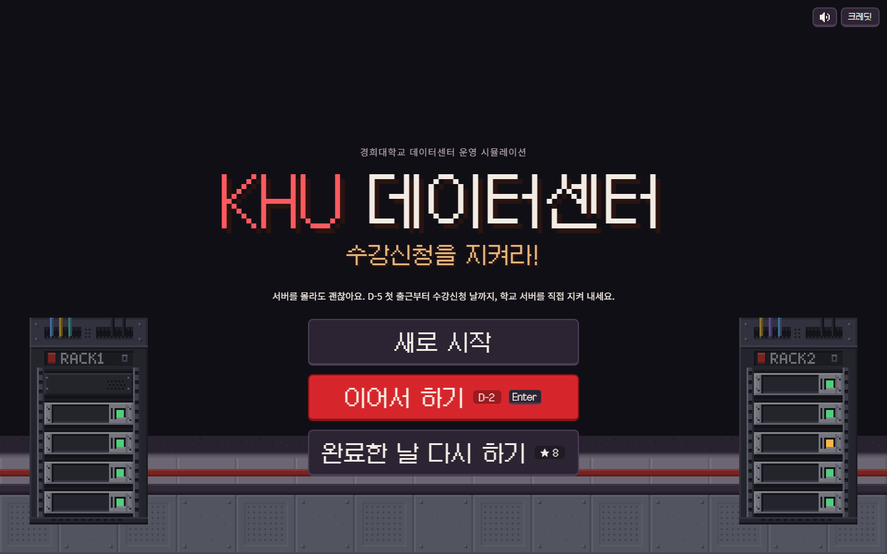
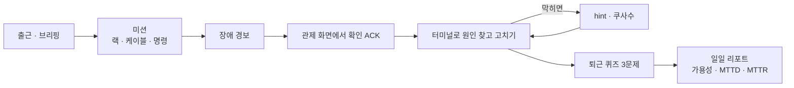
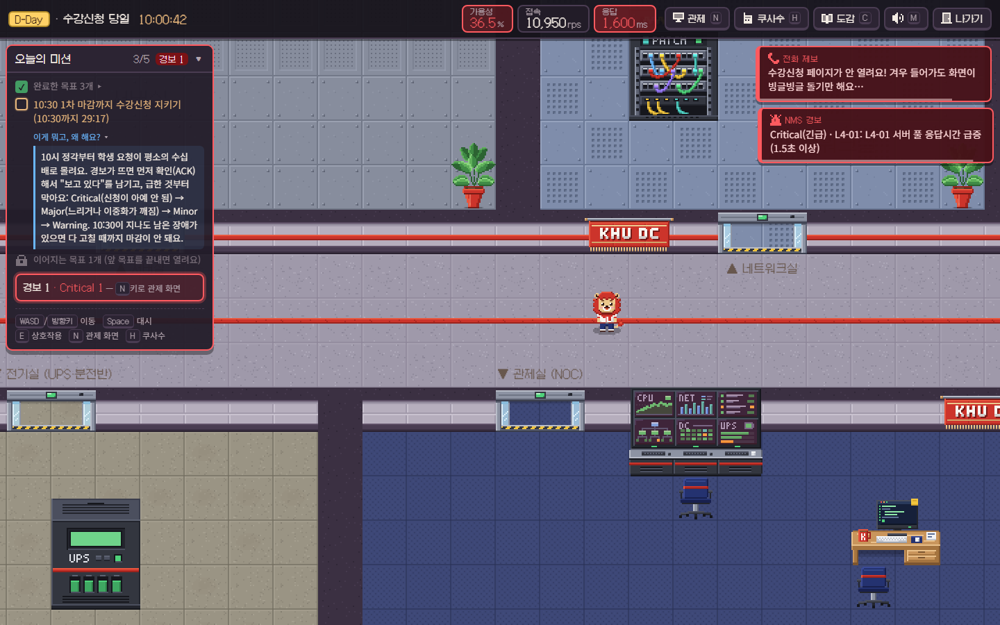
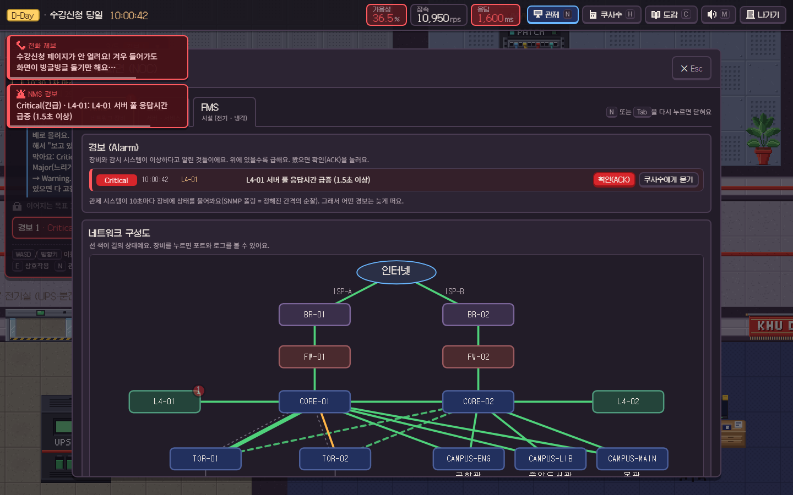
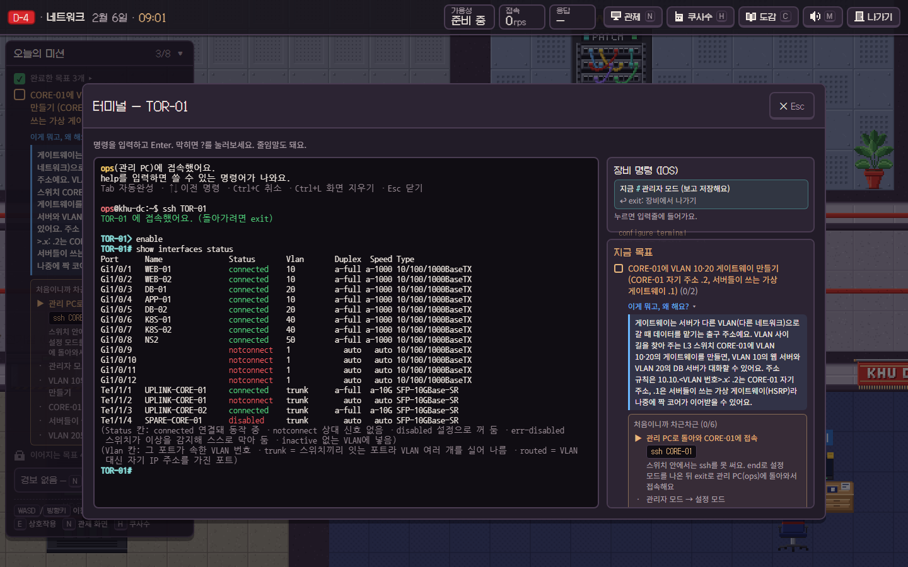
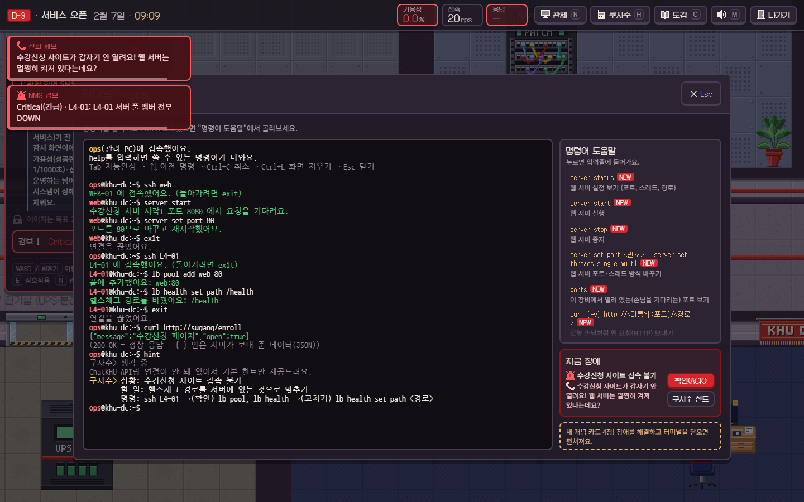
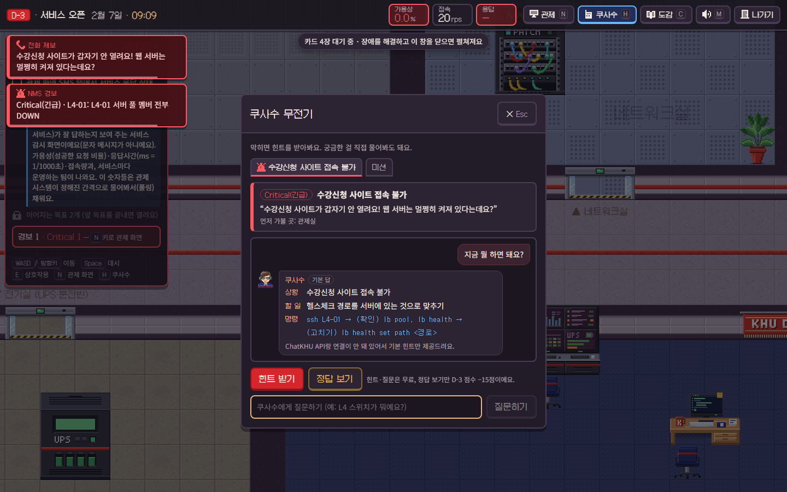
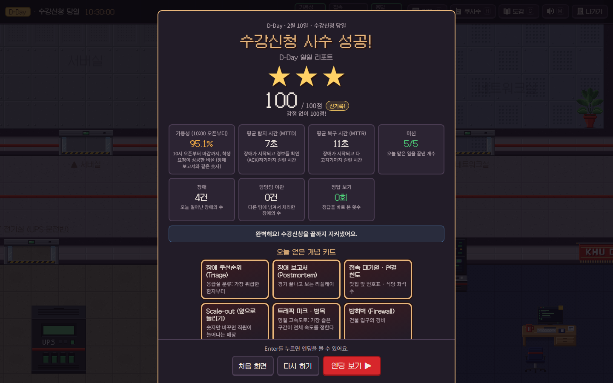
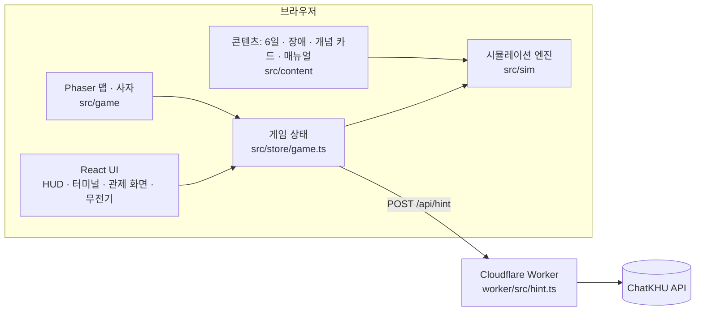

# KHU 데이터센터: 수강신청을 지켜라

<h2 align="center"><a href="https://khu-dc-game.khu-dc-game-worker.workers.dev">▶ 지금 바로 플레이하기</a></h2>

<p align="center">
  <b>올클의 운명은 당신의 터미널에 달렸다.</b><br/>
  오전 10시 정각, 수강신청 서버가 터지기 전에 출근하세요!<br/>
  <a href="https://khu-dc-game.khu-dc-game-worker.workers.dev">khu-dc-game.khu-dc-game-worker.workers.dev</a> · 설치 없이 브라우저에서 바로 · AI 사수 쿠사수 대기 중
</p>

경희대학교 데이터센터의 신입 엔지니어가 되어 **5일 동안 서버실을 직접 꾸리고, D-Day 아침 10시에 열리는 수강신청을 지켜내는** 브라우저 픽셀 게임이에요.

[](https://khu-dc-game.khu-dc-game-worker.workers.dev)

- **팀**: strawberry cone
- **플레이**: [링크](https://khu-dc-game.khu-dc-game-worker.workers.dev)를 누르면 바로 시작. 6일(D-5 → D-Day), 다 하면 1시간쯤. 키보드가 있는 PC 브라우저에서 해 주세요
- **누구나**: 서버를 거의 몰라도 괜찮아요. 랙에 서버를 끼우는 것부터 시작해요
- **AI 사수**: 막히면 쿠사수가 상황 · 할 일 · 명령을 3줄로 알려 줘요 (ChatKHU. 공개 사이트에선 켜져 있어요)

**목차** · [이런 게임이에요](#이런-게임이에요) · [스크린샷](#스크린샷) · [바로 해보기](#바로-해보기) · [주요 기능](#주요-기능) · [6일 동안 하는 일](#6일-동안-하는-일) · [조작법](#조작법) · [AI 사수 쿠사수](#ai-사수-쿠사수-chatkhu) · [프로젝트 구조](#프로젝트-구조) · [개발자 안내](#개발자-안내) · [에셋 · 라이선스](#에셋--라이선스)

---

## 이런 게임이에요

- **진짜 운영처럼 배워요.** 하루에 한 층씩 쌓아요: 물리(랙 · 전원 · 케이블) → 네트워크(VLAN · 게이트웨이 · DHCP · DNS) → 서비스(포트 · L4 · MSA) → 컨테이너와 링크(Docker · LACP · STP) → 이중화(쿠버네티스 · HSRP) → 수강신청 당일.
- **답 대신 증상이 와요.** "사이트가 안 열려요" 같은 제보와 관제 경보만 보고, 터미널로 원인을 찾아 직접 고쳐요.
- **혼자가 아니에요.** 막히면 터미널에 `hint`. AI 사수 쿠사수가 지금 상황과 할 일, 쓸 명령을 알려 줘요. 정답 값(어느 포트, 몇 번 VLAN …)은 빈칸으로 남겨서 마지막 한 걸음은 직접 해요.

하루는 이렇게 흘러가요.



## 스크린샷

| 데이터센터 맵 (D-Day 10:00, 문 열자마자 제보와 경보) | 관제 화면 NMS (Critical 경보) |
|---|---|
|  |  |
| **스위치 터미널: `ssh TOR-01` → `show interfaces status`** | **터미널에서 `hint`: 쿠사수의 상황 · 할 일 · 명령** |
|  |  |
| **쿠사수 무전기 (H): 같은 답과 정답 보기** | **일일 리포트 (D-Day)** |
|  |  |

## 바로 해보기

**온라인**: [khu-dc-game.khu-dc-game-worker.workers.dev](https://khu-dc-game.khu-dc-game-worker.workers.dev) 를 열면 끝이에요. 설치도 가입도 필요 없어요. 공개 사이트에는 AI 사수(ChatKHU)가 켜져 있어서, 터미널에 `hint` 만 치면 쿠사수가 바로 답해요.

**내 컴퓨터에서**: **Node.js 20.19 이상** (22 LTS 권장)

```bash
npm install
npm run dev          # → http://localhost:5173
npx playwright install chromium # 브라우저에서 실행하고싶다면
```

**새로 시작**은 D-5 첫 출근부터, **이어서 하기**는 마지막으로 간 날부터 시작해요. 끝낸 날은 **완료한 날 다시 하기**에서 골라 별 3개에 다시 도전할 수 있어요. 진행은 브라우저에 저장돼요.

AI 키 없이도 끝까지 플레이할 수 있어요. 그때 쿠사수는 장애마다 미리 적어 둔 3줄로 답해요. AI까지 켜려면 [ChatKHU 연결하기](#chatkhu-연결하기)를 보세요.

## 주요 기능

| 기능 | 내용 |
|---|---|
| **6일 커리큘럼** | 날마다 새 장비와 개념이 열리고, 그날 배운 것으로 꼭 하나씩 장애가 나요. 마지막 날은 실시간 수강신청 |
| **진짜 장비 같은 터미널** | 관리 PC의 리눅스 셸, `ssh CORE-01` 로 들어가는 스위치 명령줄(Cisco IOS 스타일: 줄임말 · `?` · Tab · `% Invalid input`), L4 · 방화벽 · DHCP · DNS 서버의 전용 명령 |
| **관제 화면 (NOC)** | NMS(네트워크 지도 · 경보) · SMS(서비스) · FMS(전기 · 냉각). 장비가 스스로 알리는 경보는 바로, 숫자로 재는 경보는 다음 감시 주기에 떠요 |
| **장애 24종 · 변형 37가지** | 증상만 보여 주고, 고쳤는지는 실제 상태(도달성, 링크, 헬스체크)로 판정해요. 어떤 장애가 섞일지는 저장 파일마다 정해진 seed로 뽑아요 |
| **AI 사수 쿠사수** | 터미널 `hint` 와 무전기(H). 상황 · 할 일 · 명령 3줄, 명령은 값만 빈칸. 무료이고, ChatKHU가 없으면 기본 답으로. 플레이어가 자기 ChatKHU 키를 넣을 수도 있어요 |
| **일일 리포트** | 가용성 · 평균 탐지 시간(MTTD) · 평균 복구 시간(MTTR) · 별 1–3개. 오늘 얻은 개념 카드와 내일 미리보기 |
| **개념 도감 (C)** | 하루하루 얻는 개념 카드. 어려운 말을 생활 속 비유로 풀어 둬요 |
| **픽셀 아트 · 사운드** | 32×32 픽셀 사자 캐릭터와 같은 밀도로 그린 맵, 배경음악과 효과음, Space 대시 |

## 6일 동안 하는 일

| 날 | 주제 | 직접 해 보는 것 | 그날 꼭 터지는 장애 |
|---|---|---|---|
| D-5 | 물리 구축 | 랙에 서버 장착 · 전원 A/B · 케이블 · 포트 불빛과 시설 보기 | 반쯤 망가진 케이블 (CRC 오류) |
| D-4 | 네트워크 | `ssh TOR-01` · VLAN · 게이트웨이 · DNS 등록 · DHCP 풀 · `write memory` | VLAN 배정 실수 · DHCP 주소 고갈 |
| D-3 | 서비스 오픈 | 수강신청 앱을 80번 포트로 · L4에 서버 등록과 헬스체크 · 앱을 기능별 서비스로 | L4 헬스체크 |
| D-2 | 컨테이너 · 링크 | Dockerfile · `docker build/push/run` · 볼륨 · 업링크 묶음(Po1) | 업링크 포화 · 루프(브로드캐스트 스톰) |
| D-1 | 점검 · 이중화 | pod 2개 이상 · CORE-02를 HSRP 짝으로 · 비운 노드 다시 열기 · 이중화 점검표 | 랙 온도 · 화재 |
| D-Day | 수강신청 당일 | 10시 전 점검 3가지 · 10:30 1차 마감까지 지키기 · 장애 보고서 | 오픈 폭주 → pod를 늘리면 DB 연결 부족 → 업링크 포화 → 10시 15분 매크로 |

- D-4 ~ D-1엔 그날이나 지난 날의 장애가 0–2개 더 섞여요. **새로 시작**하면 다른 판이 돼요.
- 하루의 마지막 미션은 설계 보드의 **복습 퀴즈 3문제**예요. 그날 한 일에서 5문제 중 3문제가 나오고, 한 번에 다 맞혀야 퇴근해요.
- 퇴근 = 미션을 다 하고, 터진 장애를 모두 고쳤을 때. D-Day는 10:30까지 버티고 장애를 다 고쳐야 끝나요 (실제 시간으로 10분쯤).

## 조작법

| 키 | 하는 일 |
|---|---|
| WASD / 방향키 | 이동 |
| Space | 대시: 앞으로 2칸 도약 (0.5초 뒤 다시) |
| E | 앞에 있는 장비와 상호작용 (랙, 스위치, PDU, 관리 PC, 관제실 모니터, 설계 보드 …) |
| N / Tab | 관제 화면 (NOC) |
| H | 쿠사수 무전기 (힌트 받기 · 질문하기) |
| C | 개념 도감 |
| M | 소리 켜기/끄기 |
| Esc | 열린 창 닫기 (창 위에서 연 창이면 원래 창으로) |
| Enter / 클릭 | 대화 넘기기 |

터미널은 관제실 책상의 **관리 PC**에서 E로 열어요(D-4부터). 창을 닫아도 장소마다 세션(접속한 장비, 모드, 스크롤, ↑ 기록, 쓰다 만 줄)이 그대로 남아요.

<details>
<summary><b>터미널 명령 모음</b> (펼치기)</summary>

#### 관리 PC: 리눅스 셸

```
ops@khu-dc:~$ help                       # 오늘 쓸 수 있는 명령
ops@khu-dc:~$ ping db                    # 응답 확인
ops@khu-dc:~$ nslookup sugang            # 이름 → 주소 (DNS)
ops@khu-dc:~$ traceroute web             # 어느 길로 가는지
ops@khu-dc:~$ curl -v http://sugang/enroll
ops@khu-dc:~$ ssh web                    # 서버로 들어가기 (돌아올 땐 exit)
ops@khu-dc:~$ hint                       # 쿠사수에게 지금 할 일 묻기 (무료)
```

`ip addr`, `hostname`, `hint` 는 언제나 돼요. 날이 갈수록 `server …`(D-3), `svc …`(D-3), `docker …`(D-2), `kubectl` · `pods` · `nodes` · `drain` · `rollout undo` · `env …`(D-1) 가 늘어나요.

#### 네트워크 장비: `ssh CORE-01`

스위치와 라우터(CORE-01/02, TOR-01/02, BR-01/02, 캠퍼스 스위치)는 **IOS 명령어**를 써요.

```
ops@khu-dc:~$ ssh TOR-01
TOR-01> enable                           # > 는 보기만, # 은 관리자
TOR-01# show interfaces status           # 포트 상태 한눈에
TOR-01# configure terminal               # 설정 모드
TOR-01(config)# interface gi1/0/5
TOR-01(config-if)# switchport access vlan 10
TOR-01(config-if)# end                   # Ctrl+Z 도 같아요
TOR-01# write memory                     # 저장! (안 하면 재부팅 때 사라져요)
```

- **줄임말**: `sh ip int br`, `conf t`, `int gi1/0/5`, `wr`. 둘 이상으로 읽히면 `% Ambiguous command`.
- **`?`** 는 그 자리에 칠 수 있는 명령을, **Tab** 은 자동 완성을 보여 줘요. 틀리면 `% Invalid input detected at '^' marker.` 가 틀린 자리를 가리켜요.
- 자주 쓰는 show: `interfaces status` · `ip interface brief` · `vlan brief` · `interfaces counters errors` · `etherchannel summary` · `standby brief` · `spanning-tree` · `logging` · `running-config`.

#### 서버마다 다른 명령

| 장비 | 들어가기 | 명령 |
|---|---|---|
| L4 (부하 분산) | `ssh L4-01` | `lb status` · `lb pool` · `lb pool add <서버> <포트>` · `lb pool del/enable/disable <서버>` · `lb health` · `lb health set path <경로>` / `port <포트>` |
| 방화벽 | `ssh FW-01` | `fw rules` · `fw top`(많이 보내는 주소 순위) · `fw deny <대역> [포트]` · `fw permit <대역> [포트]` · `fw del <번호>` |
| DHCP 서버 | `ssh dhcp01` | `dhcp pool list` · `dhcp pool show <풀>` · `dhcp pool set <풀> range <시작> <끝>` · `dhcp leases <풀>` · `dhcp leases clear <풀>` |
| DNS 서버 | `ssh ns1` | `dns list` · `dns add <이름> <IP>` · `dns del <이름>` |

</details>

<details>
<summary><b>관제 화면과 일일 리포트 자세히</b> (펼치기)</summary>

#### 관제 화면 (N · Tab · 관제실 모니터에서 E)

- **NMS (네트워크)**: 데이터센터와 캠퍼스 네트워크 지도. 선 색이 사용률과 상태를 보여 줘요. 장비를 누르면 포트별 상태, CRC 오류 수, 장비 일기장(syslog), **SSH** 버튼이 나와요.
- **경보 목록**: 심각도 순(Critical → Major → Minor → Warning). 경보마다 **확인(ACK)** · **쿠사수에게 묻기** · (캠퍼스 서비스처럼 우리 손이 닿지 않는 경보엔) **담당팀 이관**.
- **SMS (서비스)**: 수강신청 응답, pod, 트래픽, DHCP 풀, DNS, KHU 포털 · LMS · 웹메일 · 도서관 응답 시간.
- **FMS (시설)**: UPS, PDU A/B, 발전기, 랙 온도 · 습도, 들어오는 전원 두 줄. 버튼은 **시설팀 통보** 하나예요.

**왜 어떤 경보는 늦게 뜰까?** 링크가 끊기거나 포트가 막히면 장비가 스스로 알려요(trap · syslog). 사용률, CRC 오류, 온도 같은 **숫자**는 NMS가 정해진 간격(평일 15초 · D-Day 10초)으로 물어볼 때만 보여요. 그래서 전화 제보가 경보보다 먼저 올 때가 있고, 그 차이가 MTTD에 찍혀요.

#### 일일 리포트

| 항목 | 뜻 |
|---|---|
| 가용성 | 서비스가 정상이었던 시간 비율 |
| MTTD (평균 탐지 시간) | 장애가 시작되고 경보를 확인(ACK)하기까지 |
| MTTR (평균 복구 시간) | 장애가 시작되고 다 고치기까지 |
| 미션 · 장애 · 담당팀 이관 | 끝낸 미션 수, 일어난 장애 수, 다른 팀에 넘긴 수 |
| 정답 보기 | 힌트와 질문은 무료. "정답 보기"(값까지 다 채운 정답)만 한 번에 15점 깎여요 |

D-Day 리포트 다음엔 수료증 엔딩이 기다려요.

</details>

## AI 사수 쿠사수 (ChatKHU)

막히면 터미널에 `hint` 를 치세요. 창이 열리지 않고 그 자리에 답이 나와요 (스위치 프롬프트에서도 돼요). 아래는 ChatKHU 키 없이 받은 기본 답이에요. 연결돼 있으면 같은 세 칸을 AI가 지금 상황을 보고 직접 써요.

```
ops@khu-dc:~$ hint
쿠사수> 생각 중…
ChatKHU API랑 연결이 안 돼 있어서 기본 힌트만 제공드려요.
쿠사수> 상황: 수강신청 사이트 접속 불가
        할 일: 헬스체크 경로를 서버에 있는 것으로 맞추기
        명령: ssh L4-01 → (확인) lb pool, lb health → (고치기) lb health set path <경로>
```

- **무엇을 보고 답하나**: 지금 터미널이 붙어 있는 장비와 모드, 최근에 친 명령 6개, 열린 미션과 장애, 관제 경보, 포트 · 링크 상태. 그 장비에서 고치는 장애를 먼저, 없으면 먼저 터진 장애, 장애가 없으면 지금 미션을 이야기해요.
- **정답 값은 빈칸**: 명령의 모양은 알려 주지만 포트 이름 · VLAN 번호 · IP 같은 값은 `<포트>` · `<번호>` 로 남겨요. AI가 값을 말하면 한 번 다시 묻고, 그래도 말하면 기본 답으로 바꿔요. 값까지 다 채운 정답은 무전기의 **정답 보기**(−15점)에만 있어요.
- **무전기 (H)에 질문하기**: "뭐 해야 돼?" 같은 질문엔 3줄로, "VLAN이 뭐야?" · "약자가 뭐야?" · "어떻게 해?" 같은 질문엔 한두 문장으로 답해요.
- **무료**: 힌트와 질문은 점수가 깎이지 않아요.
- **AI가 없을 때**: 장애마다 미리 적어 둔 같은 3줄로 답하고, 위처럼 이유를 한 줄 붙여요.

AI에게 보내는 프롬프트는 [`worker/src/hint.ts`](worker/src/hint.ts) 에, 날마다 읽히는 운영 매뉴얼은 [`src/content/manual/`](src/content/manual/) 에 있어요.

### ChatKHU 연결하기

1. ChatKHU 로그인 → 왼쪽 아래 **API Gateway** → **API 키 생성**
2. 키 파일 만들고 Worker 켜기 (`worker/.dev.vars` 는 `.gitignore` 에 들어 있어요. **키는 절대 커밋하지 마세요.**)
   ```bash
   cd worker
   npm install
   cp .dev.vars.example .dev.vars    # 마지막 줄 CHATKHU_API_KEY= 뒤에 키를 붙여 넣기
   npm run dev                       # → http://localhost:8787
   ```
3. 다른 터미널의 루트에서 `npm run dev`. Vite가 `/api` 요청을 `:8787` 로 넘겨줘요(`vite.config.ts` 의 proxy).
4. 게임 터미널에서 `hint`. "ChatKHU API랑 연결이 안 돼 있어서 …" 줄이 없고 무전기 배지가 **AI** 면 연결된 거예요. "ChatKHU 응답이 없어서 …" 가 나오면 키를 다시 확인하세요.

### 플레이어가 자기 키 넣기

서버에 키가 없어도, 플레이어가 각자 자기 ChatKHU 키를 넣으면 AI 사수가 켜져요.

1. 타이틀 화면 오른쪽 위 **ChatKHU 키**, 또는 게임 중 무전기(H) 위쪽의 **ChatKHU 키** 를 눌러요.
2. 키를 붙여 넣고 **연결 확인** (ChatKHU를 아주 짧게 한 번 불러요) → **저장**.
3. 기본은 이 탭에서만 기억해요. **이 브라우저에 기억하기** 를 켜면 브라우저를 닫아도 남아요 (공용 PC에서는 끄세요). **지우기** 로 언제든 지워요.

- 쓰는 순서: 플레이어 키 → 서버 키(`CHATKHU_API_KEY`) → 기본 힌트.
- 키는 브라우저에만 있고, 힌트를 물을 때만 `x-chatkhu-key` 헤더로 Worker를 거쳐 ChatKHU로 가요. Worker는 그 한 번에만 쓰고 저장하거나 기록하지 않아요. (브라우저가 ChatKHU를 직접 부르지 않는 건, 프롬프트에 장애의 정답이 들어 있어서 개발자 도구로 보이면 안 되기 때문이에요.)
- 틀린 키면 "넣은 ChatKHU 키가 맞지 않아서 기본 힌트로 드려요. …" 가 나와요.

## 프로젝트 구조

**기술 스택**: TypeScript 5.9 · React 19 · Phaser 3.90 (맵) · Zustand 5 (상태) · xterm.js 5 (터미널) · Vite 7 · Vitest 4 · Playwright · Cloudflare Workers (`/api/hint`, ChatKHU 프록시)



시뮬레이션 엔진(`src/sim`)은 React와 Phaser 없이 돌아가는 순수 TypeScript라서, 네트워크 · 명령 · 장애를 화면 없이 테스트할 수 있어요.

```
src/
  sim/          시뮬레이션 엔진: 세상(장비 · 케이블 · 전원 · 네트워크 · 앱 · Docker · k8s), 시계, 경보, 점수
    net/          포트 상태 · VLAN · STP · HSRP · LACP · 도달성 · 링크 부하 · DHCP · DNS · 방화벽 · L4
    ios/          스위치 명령줄: 파서(줄임말 · ? · Tab · % 에러), 명령 트리, show 출력
    commands/     리눅스 셸 명령 (net · web · svc · docker · k8s · lb · fw · dhcp)
  content/      게임 내용
    days/         day0.ts … day5.ts = D-5 … D-Day (미션 · 대화 · 그날의 장애)
    incidents/    장애 템플릿 (d5 · d4 · d3 · d2 · d1 · dday)
    manual/       AI 사수가 읽는 운영 매뉴얼
    topology.ts   D-Day 아침의 전체 네트워크
    concepts.ts   개념 카드
  ai/           AI 사수: client.ts (요청 · 기본 답) · answer.ts (3줄) · blanks.ts (값 빈칸) · leak.ts (정답 값 검사)
  store/        게임 상태 (화면, 창, 터미널 세션, 대화, 힌트, 저장)
  ui/           React 화면 (HUD, 미션, 터미널, 무전기, 미니게임, 설계 보드, 리포트, 엔딩)
    noc/          관제 화면: NMS · SMS · FMS
  game/         Phaser 맵, 사자, 대시, 코드로 그린 픽셀 아트 (art/)
  audio/        배경음악 · 효과음 · 경보 소리
worker/         Cloudflare Worker: 게임 파일 서빙 + POST /api/hint
tests/          Vitest: 네트워크 · IOS · 명령 · 엔진 · AI 가드 · 저장 · 6일 자동 플레이
e2e/            Playwright: 화면 · 터미널 · 저장 · 소리 · 6일 전체 플레이
art/lion_sprite/  사자 스프라이트 원본 · 메타데이터 · 생성 스크립트
docs/           스크린샷 · 에셋 목록 (ASSETS.md)
```

## 개발자 안내

```bash
npm test                              # Vitest: 단위 테스트 + 6일 × seed 12개 자동 플레이
npx playwright install chromium       # (처음 한 번) 브라우저 설치
npx playwright test                   # Playwright: 화면 · 저장 · 소리 · 6일 전체 플레이 (콘솔 에러 0)
npm run typecheck && npm run typecheck:worker
npm run build                         # → dist/
```

Playwright는 `http://localhost:5173` 의 개발 서버를 쓰고, 꺼져 있으면 직접 켜요. 다른 포트는 `E2E_PORT=5280 npx playwright test`. 6일 전체 플레이는 날마다 맵 · 관제 화면 · 터미널 · 리포트를 찍어서 `test-results/` 에 남겨요 (위 스크린샷 일부도 여기서 골랐어요).

<details>
<summary><b>장애 추가하기</b></summary>

장애는 `src/content/incidents/*.ts` 의 **템플릿**이에요. 한 템플릿이 변형(예: 어느 포트 · 어느 VLAN)을 여러 개 가질 수 있고, 판마다 seed로 하나가 뽑혀요(id는 `<템플릿>:<변형 번호>`, 예: `d4-dns:0`).

1. `src/sim/scenario.ts` 의 `IncidentTemplate` 를 보세요. `make(v)` 가 돌려주는 장애에 필요한 것:
   - `title`, `alert` (플레이어가 보는 **증상**. 원인은 쓰지 않기), `severity` (`critical` · `major` · `minor` · `warning`)
   - `alarm` (NMS 경보: `source` 가 `trap` · `syslog` 면 바로, `poll` 이면 다음 폴링 때), `room`
   - `inject` (세상을 망가뜨리기), `check` (고쳐졌는지: 플래그 말고 실제 상태로. 예: 도달성, 링크 상태, L4 헬스)
   - `solution` (정답 보기 문구), `solutionSteps` (정답을 실제로 하는 단계: `{cmd, host}` · `{ios: [...], host}` · `{action, label}`)
   - `todo` (쿠사수의 "할 일" 한 줄, 값 없이 40자 안쪽), `checks` (먼저 볼 확인 명령, 값 없이), 명령 없이 고치는 장애면 `fixHow`. 고치는 명령의 모양(값은 빈칸)은 `solutionSteps` 에서 자동으로 만들어요(`src/ai/blanks.ts`)
   - `bannedPhrases` (AI가 말하면 안 되는 **값**: 어느 포트 · VLAN · 앱 · 서버인지. 값이 든 정답 명령과 그 안의 IP · 포트 · VLAN은 줄임말까지 자동으로 막아요. 값 없는 명령 모양(`access vlan`, `no shutdown` …)은 넣지 마세요), `hints` 3개 (명령 · 값 없이 쓴 짧은 힌트)
   - 필요하면 `escalate` (담당팀 이관), 그리고 `concept`, `lesson`
2. `day` 에 처음 나오는 날을, `until` 에 마지막 날을 적어요. 그날의 가르치는 장애로 쓰려면 `src/content/days/dayN.ts` 의 `fixed` 에, 아니면 그날부터 섞이는 후보로 자동으로 들어가요 (`weight` 로 비율 조절).
3. AI 사수가 알 수 있게 `src/content/manual/dayN.md` 에 진단 순서(무엇을 보고, 어떤 명령으로, 정상/비정상은 어떻게 보이는지)를 적어요.
4. `npm test`: 6일 × seed 12개를 자동으로 플레이하면서 장애가 **정말 망가뜨리는지**, `solutionSteps` 로 **정말 고쳐지는지**, 쿠사수의 3줄이 **정답 값을 흘리지 않는지** 검사해요.

</details>

<details>
<summary><b>사자 그림 바꾸기</b></summary>

사자는 32×32 픽셀 시트 한 장이에요: `public/assets/sprites/lion.png` (원본 · 메타데이터 · 생성 스크립트는 `art/lion_sprite/`).

- 6열 × 12행, 한 칸 32×32. 행 순서 = idle 아래·왼쪽·오른쪽·위 (4프레임) → run 아래·왼쪽·오른쪽·위 (6프레임) → interact 아래·왼쪽·오른쪽·위 (4프레임, 한 번 재생). 재생 속도는 `src/game/sprites/lion.ts`.
- 맵 한 칸 = 32×32 아트 픽셀 = 화면 64px(2배). 시트를 고칠 때도 32×32 격자를 지켜 주세요.
- 먼지 효과: `dust_puff.png` · `dust_side_left.png` · `dust_side_right.png` (16×16 × 6프레임, `art/lion_sprite/effects/dust.json`).
- 대화 초상화와 맵의 나머지 그림은 이미지 파일 없이 코드로 그린 같은 밀도의 픽셀 아트예요: `src/game/art/` (`portraits.ts`, 공용 색 `palette.ts`).

</details>

<details>
<summary><b>배포 (Cloudflare Workers)</b></summary>

Worker 하나가 게임 정적 파일(`dist/`)과 `/api/hint` 를 함께 서빙해요. 지금 공개된 버전: [khu-dc-game.khu-dc-game-worker.workers.dev](https://khu-dc-game.khu-dc-game-worker.workers.dev) (Cloudflare Workers 무료 플랜).

```bash
npm run build                                  # → dist/
cd worker
npx wrangler login                             # 처음 한 번
npx wrangler secret put CHATKHU_API_KEY        # (선택) 키는 secret 으로. 없으면 플레이어가 각자 키를 넣어요
npx wrangler deploy
```

- 설정: `worker/wrangler.toml` (`[assets] directory = "../dist"`, SPA 모드, `/api/*` 만 Worker 코드가 먼저 처리)
- 모델 바꾸기: `[vars] HINT_MODEL` (기본 `claude-haiku-5-5`, ChatKHU 게이트웨이에서 동작 확인)
- 서버 키는 `wrangler secret put CHATKHU_API_KEY` 한 번이면 배포된 Worker에 바로 붙고, 다음 배포 때도 그대로 남아요. 이름은 꼭 `CHATKHU_API_KEY` 로 쓰고, 키 값은 물어볼 때만 붙여 넣으세요.
- 게이트웨이는 User-Agent가 없는 요청을 막아요(403, `error code: 1010`). Worker가 알아서 붙여 보내요.
- 번들만 확인: `cd worker && npx wrangler deploy --dry-run --outdir /tmp/khu-worker-dry`
- Worker의 `npm run dev` 는 `dist/` 가 없으면 빈 폴더를 먼저 만들어요. `:8787` 에서 게임 화면까지 보려면 루트에서 `npm run build` 를 먼저 하세요.

</details>

<details>
<summary><b>AI 호출 기록</b></summary>

`/api/hint` 는 AI를 부를 때마다 JSON 한 줄을 `console.log` 로 남겨요. API 키와 질문 원문은 남기지 않아요.

```json
{"event":"hint","ts":"2026-10-29T11:31:23.749Z","mode":"incident","scenarioId":"d4-dns:0","want":"guide","kind":"guide","model":"claude-haiku-5-5","latencyMs":1830,"leaked":false,"retried":false,"replyLength":96,"outcome":"ok","inputTokens":2310,"outputTokens":61,"questionLength":0}
```

- `want`: `guide`(터미널 `hint`, 무전기 버튼: 3줄로 답하라고 함) · `auto`(질문을 보고 AI가 고름). `kind`: AI가 실제로 준 답 (`guide` 3줄 · `explain` 짧은 설명).
- `leaked`: AI 답에 정답 값이 들어가서 한 번 다시 물었는지. 두 번째도 그러면 기본 답으로 대체(`outcome: "fallback"`, `reason: "leak"`).
- `reason`: 기본 답으로 돌아간 이유 (`leak` · `timeout` · `upstream` · `badkey`: 플레이어 키가 거절됨). 키가 없거나(`nokey`) 요청이 너무 많을 때(`rate`)는 AI를 부르지 않아서 기록이 남지 않아요.
- `ownKey`: 플레이어가 넣은 키로 불렀는지 (`true` / `false`). 키 자체는 남기지 않아요. 연결 확인은 `{"event":"key-check", …, "outcome": "ok"}` 한 줄로 남아요.
- `error`: 실패했을 때 게이트웨이가 한 말을 짧게 (예: `upstream 401: Invalid API key`, `upstream 403: error code: 1010`).
- 로컬은 `wrangler dev` 터미널에 그대로 찍혀요. 배포본은 이렇게 모아요:

```bash
cd worker
npx wrangler tail --format json > ai-usage.json      # 플레이하는 동안 켜두기 (Ctrl+C 로 종료)
jq -c '.logs[]?.message[]? | fromjson? | select(.event == "hint")' ai-usage.json > hint-log.jsonl
```

`hint-log.jsonl` 한 줄 = AI 호출 한 번이에요. 호출 수, 평균 응답시간(`latencyMs`), 토큰 수, 유출 차단 횟수(`leaked`)를 표로 정리하면 돼요.

</details>

## 에셋 · 라이선스

게임에 들어간 음악, 효과음, 폰트, 라이브러리와 라이선스는 [`docs/ASSETS.md`](docs/ASSETS.md) 에 있어요. 게임 안에서는 타이틀 화면 오른쪽 위 **크레딧** 에서 볼 수 있어요.
